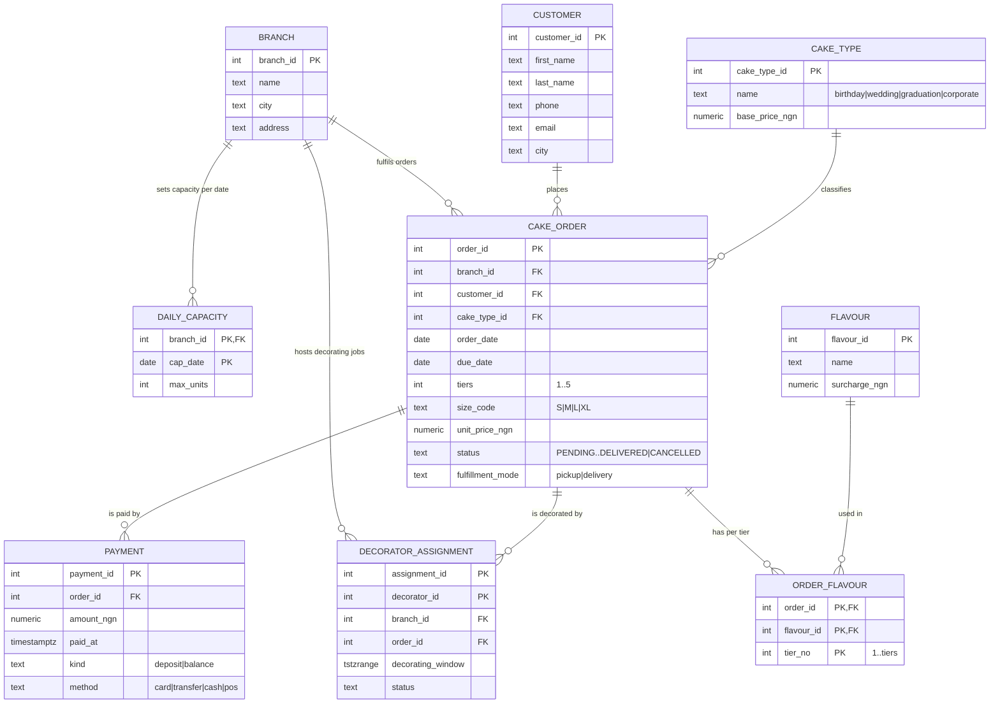

# Portfolio 1 — ER Diagram (Mermaid)

**Case study:** SweetCrust Bakery — custom cake orders across 4 branches
(Lagos: Surulere, Lekki, Ikeja; Ibadan: Bodija).

~9 entities: `branch`, `daily_capacity`, `customer`, `cake_type`, `flavour`,
`cake_order`, `order_flavour`, `payment`, `decorator_assignment`.

## ER Diagram (Mermaid)

## Cardinality summary

- A **branch** has one `daily_capacity` row per date (composite PK).
- A **cake_order** belongs to exactly one branch and one customer.
- `order_flavour` resolves the many-to-many between `cake_order` and
  `flavour`, with one flavour per tier (the tier number is part of the PK).
- A `decorator_assignment` maps one decorator to one order over a
  `tstzrange` window; overlapping windows for the same decorator are
  forbidden by a `btree_gist` EXCLUDE constraint (P1 constraint b).
- A `payment` is either a `deposit` or a `balance` row on an order.

## Constraint legend (mapped to SQL in `schema.sql` / `constraints.sql`)

| Tag | Constraint |
| --- | --- |
| C1 | `daily_capacity` cannot be exceeded by cake units on a due date (trigger `trg_check_capacity`) — 1 tier = 1 unit, so a 3-tier cake = 3 units. |
| C2 | `decorator_assignment` windows cannot overlap per decorator (EXCLUDE USING `btree_gist`). |
| C3 | `due_date >= order_date + 2` (CHECK on `cake_order`). |
| C4 | Deposit ≥ 50% of `unit_price_ngn` before status can become `CONFIRMED` (trigger `trg_deposit_before_confirm`). |
| C5 | `tiers BETWEEN 1 AND 5`; `unit_price_ngn > 0`; `amount_ngn > 0`; `max_units > 0`. |
| C6 | Status transition follows `PENDING → CONFIRMED → BAKING → DECORATING → READY → COLLECTED|DELIVERED`, or `CANCELLED` (trigger `trg_status_fsm`). |
